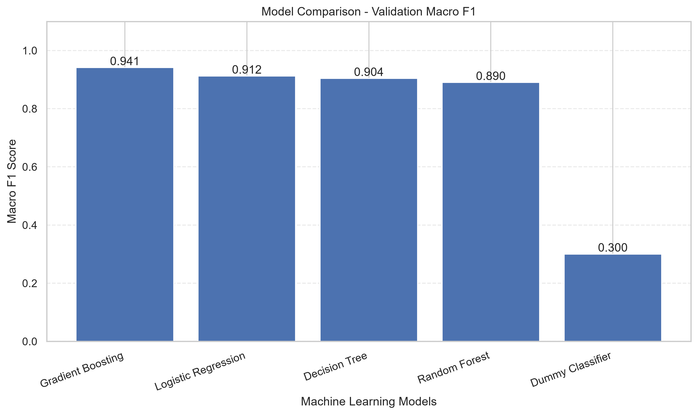

# Social Media Impact on Student Life – Machine Learning Project

An end-to-end machine learning application that explores the relationship between students' social media usage, sleep, wellbeing and academic-related attributes, and predicts the dataset's `Overall_Impact` category.

The project includes data validation and cleaning, exploratory data analysis (EDA), feature engineering, model comparison, hyperparameter tuning, evaluation, model versioning, experiment tracking with MLflow, and an interactive Streamlit application.

> **Important:** This is an educational machine learning project. Its predictions are based on patterns in the supplied dataset. They are not medical, psychological, academic or other professional assessments, and should not be used to make decisions about individual students.

---

## Table of Contents

- [Project Overview](#project-overview)
- [Application Features](#application-features)
- [Technology Stack](#technology-stack)
- [Dataset](#dataset)
- [Machine Learning Workflow](#machine-learning-workflow)
- [Algorithms Compared](#algorithms-compared)
- [Model Evaluation](#model-evaluation)
- [Project Structure](#project-structure)
- [Installation](#installation)
- [Run the Application](#run-the-application)
- [Train and Compare Models](#train-and-compare-models)
- [Make a Prediction](#make-a-prediction)
- [MLflow Experiment Tracking](#mlflow-experiment-tracking)
- [Run Tests](#run-tests)
- [Generated Files and Reports](#generated-files-and-reports)
- [Limitations and Future Improvements](#limitations-and-future-improvements)
- [Disclaimer](#disclaimer)

---

## Project Overview

Social media is part of many students' everyday lives. Usage patterns can occur alongside differences in sleep, stress, social comparison and academic performance.

This project uses a structured dataset of **4,500 records and 16 original columns** to train classification models that predict one of three target categories in the `Overall_Impact` column:

| Target class | Description |
|---|---|
| `Beneficial` | The record is labelled as having a beneficial overall impact. |
| `Neutral` | The record is labelled as having a neutral overall impact. |
| `Negative` | The record is labelled as having a negative overall impact. |

The application allows users to inspect the dataset, review cleaning and EDA outputs, train and compare classification algorithms, and enter student-related attributes to obtain a model prediction and class probabilities.

## Application Features

The Streamlit application is organized into four sections:

### 1. Data Overview

- Dataset summary and preview.
- Column data types and missing-value information.
- Target class distribution.

### 2. Cleaning & EDA

- Before-and-after data cleaning review.
- Missing-value inspection and imputation information.
- Feature engineering preview.
- Exploratory data analysis visualizations.

### 3. Train Models

- Comparison of five classification algorithms.
- Model evaluation using multiple classification metrics.
- Hyperparameter tuning with `GridSearchCV`.
- Selection using Macro F1, with Balanced Accuracy as the tie-breaker.
- Saving trained model versions and metadata.
- MLflow experiment tracking.

### 4. Prediction

- Form-based input for student and social-media-related attributes.
- Loads the model referenced by `models/latest_model.json`.
- Displays the predicted `Overall_Impact` class and class probabilities.
- Stores prediction history in a CSV file.

## Technology Stack

| Area | Tools / Libraries |
|---|---|
| Programming language | Python |
| Data handling | Pandas, NumPy |
| Machine learning | Scikit-learn |
| Data visualization | Matplotlib, Seaborn |
| Interactive application | Streamlit |
| Experiment tracking | MLflow |
| Model persistence | Joblib |
| Reports and data files | CSV, JSON |
| Testing | Pytest |

## Dataset

**File:** `data/Social_media_impact_on_life.csv`

**Shape:** 4,500 rows × 16 columns (original dataset)

### Dataset columns

| Column | Description / role |
|---|---|
| `Student_ID` | Student record identifier; excluded from model features. |
| `Age` | Age value in the dataset. |
| `Gender` | Gender category. |
| `Academic_Level` | Student's academic level. |
| `Primary_Platform` | Primary social media platform. |
| `Daily_Usage_Hours` | Daily social media usage hours. |
| `Weekend_Extra_Hours` | Additional usage hours on weekends. |
| `Device_Type` | Device category. |
| `Sleep_Duration_Hours` | Sleep duration in hours. |
| `Sleep_Quality_Score` | Sleep quality score. |
| `Late_Night_Usage` | Indicates late-night usage. |
| `Social_Comparison_Frequency` | Frequency of social comparison. |
| `Perceived_Stress_Score` | Perceived stress score. |
| `Mental_Health_Index` | Mental health index value. |
| `Academic_Performance_GPA` | Academic performance GPA value. |
| `Overall_Impact` | Target class to predict. |

### Target distribution in the supplied dataset

| Class | Records | Approximate share |
|---|---:|---:|
| Beneficial | 3,681 | 81.8% |
| Neutral | 654 | 14.5% |
| Negative | 165 | 3.7% |
| **Total** | **4,500** | **100%** |

The target classes are imbalanced. For this reason, the project considers Macro F1 and Balanced Accuracy in addition to accuracy.

> **Dataset provenance:** The supplied project files do not establish the dataset's original collection source or whether the records are synthetic, survey-based or otherwise collected. Add the original source, license, collection method and usage permissions here if those details are available. Do not describe the data as real-world or anonymized unless that is verified.

## Machine Learning Workflow

The project follows this workflow:

1. **Load data** – read the CSV dataset.
2. **Validate schema** – check required columns and expected data structure.
3. **Clean data** – inspect duplicates, missing values, invalid values and numeric ranges.
4. **Engineer features** – derive additional usage-related features.
5. **Separate features and target** – use `Overall_Impact` as the target and exclude `Student_ID` from model inputs.
6. **Split the dataset** – create training, validation and test subsets using the project's configured split logic.
7. **Build preprocessing pipeline** – process numeric and categorical columns separately.
8. **Compare algorithms** – evaluate the five candidate classifiers.
9. **Tune the selected model** – use GridSearchCV with stratified cross-validation.
10. **Evaluate** – report performance on the held-out test data.
11. **Save artifacts** – persist the fitted pipeline, metadata and latest-model pointer.
12. **Predict** – load the saved pipeline in the Streamlit prediction section.

### Feature engineering

The data pipeline creates the following derived features:

| Engineered feature | Description |
|---|---|
| `Total_Usage_Hours` | Daily usage hours plus weekend extra usage hours. |
| `Usage_to_Sleep_Ratio` | Daily usage hours divided by sleep duration, with the implementation's handling for invalid or zero values. |
| `Late_Night_Usage_Hours_Flag` | Daily usage hours multiplied by the late-night usage indicator. |

### Preprocessing

The Scikit-learn preprocessing pipeline applies separate transformations to numeric and categorical features.

**Numeric features**

- Missing values are imputed using the median.
- Features are scaled using `StandardScaler`.

**Categorical features**

- Missing values are imputed using the most frequent value.
- Categories are encoded using `OneHotEncoder`.

The preprocessing steps are part of the fitted model pipeline so the same transformations can be applied during prediction.

## Algorithms Compared

The application compares these five classifiers:

| Algorithm | Purpose |
|---|---|
| Dummy Classifier | Baseline for comparison. |
| Logistic Regression | Linear classification baseline. |
| Decision Tree | Rule-based classification model. |
| Random Forest | Ensemble of decision trees. |
| Gradient Boosting | Sequential boosting-based classifier. |

### Model selection and tuning

- **Primary selection metric:** Macro F1.
- **Tie-breaker:** Balanced Accuracy.
- **Tuning method:** `GridSearchCV`.
- **Cross-validation:** `StratifiedKFold` with 3 folds.
- **Cross-validation scoring:** `f1_macro`.

The saved best model in the supplied project is **Gradient Boosting** (model version 13).

## Model Evaluation

The following metrics are recorded in `reports/best_model_metrics.json` for the saved model. These are the results stored in the supplied project artifacts; they are not a claim of independently reproduced results.

### Held-out test results

| Metric | Score |
|---|---:|
| Accuracy | 97.56% |
| Balanced Accuracy | 94.02% |
| Macro F1 | 94.27% |
| Weighted F1 | 97.56% |

### Per-class test results

| Class | Precision | Recall | F1-score | Support |
|---|---:|---:|---:|---:|
| Beneficial | 98.91% | 98.78% | 98.84% | 736 |
| Negative | 93.75% | 90.91% | 92.31% | 33 |
| Neutral | 90.98% | 92.37% | 91.67% | 131 |

### Best Gradient Boosting hyperparameters

The saved tuning report records these values:

| Parameter | Value |
|---|---:|
| `learning_rate` | `0.05` |
| `max_depth` | `3` |
| `max_features` | `null` |
| `min_samples_leaf` | `3` |
| `min_samples_split` | `10` |
| `n_estimators` | `150` |
| `subsample` | `0.7` |

### Evaluation note

The saved report records a Macro F1 score of approximately **99.96%** on the combined training-plus-validation data and **94.27%** on the held-out test data, a gap of approximately **5.69 percentage points**. The report flags this as a moderate training-test gap. The dataset's class imbalance and the way the target was created should also be investigated before interpreting these scores as evidence of real-world predictive performance.

## Project Structure

```text
SMP/
│
├── app.py                              # Streamlit application
├── requirements.txt                   # Runtime dependencies
├── requirements-dev.txt               # Development and test dependencies
├── .gitignore
│
├── data/
│   └── Social_media_impact_on_life.csv # Input dataset
│
├── src/
│   ├── __init__.py
│   ├── config.py                       # Project paths and configuration
│   ├── data.py                         # Loading, validation, cleaning, features
│   ├── train.py                        # Model training and tuning workflow
│   └── visualizations.py               # EDA and evaluation charts
│
├── tests/
│   └── test_data_pipeline.py           # Data pipeline tests
│
├── models/
│   ├── latest_model.json               # Pointer to the latest saved model
│   ├── model_v*.joblib                 # Saved model pipelines
│   └── model_v*_metadata.json          # Model metrics and metadata
│
├── predictions/
│   └── prediction_history.csv           # Saved prediction history
│
├── reports/
│   ├── best_hyperparameters.json
│   ├── best_model_metrics.json
│   ├── classification_report.json
│   ├── model_comparison.csv
│   ├── data_cleaning_report.json
│   ├── hyperparameter_tuning_results.csv
│   ├── test_predictions.csv
│   └── figures/                        # Generated visualizations
│
└── mlflow.db                           # Local MLflow tracking database
```

Some folders and files are generated when the application or training workflow runs. The exact contents can therefore change over time.

## Installation

### Prerequisites

- Python installed on your computer.
- Git (optional, for cloning the repository).
- A terminal such as Command Prompt, PowerShell or the VS Code terminal.

Python 3.10 or newer is a practical environment choice for this project. The dependency versions are specified in `requirements.txt`.

### 1. Clone the repository

Replace the URL below with your GitHub repository URL:

```bash
git clone https://github.com/<your-username>/<your-repository>.git
cd <your-repository>
```

Alternatively, download the repository as a ZIP file and extract it.

### 2. Create a virtual environment

**Windows (PowerShell / Command Prompt):**

```bash
python -m venv .venv
.venv\Scripts\activate
```

**macOS / Linux:**

```bash
python3 -m venv .venv
source .venv/bin/activate
```

### 3. Upgrade pip

```bash
python -m pip install --upgrade pip
```

### 4. Install dependencies

For normal application use:

```bash
pip install -r requirements.txt
```

To install the testing dependency as well:

```bash
pip install -r requirements-dev.txt
```

## Run the Application

From the project root directory, run:

```bash
streamlit run app.py
```

Streamlit will display a local URL in the terminal, normally:

```text
http://localhost:8501
```

Open that address in your browser.

**Important:** Keep the project folders (`data`, `src`, `models`, `reports` and `predictions`) in their expected relative locations. The application uses paths defined in `src/config.py`.

## Train and Compare Models

1. Start the application using `streamlit run app.py`.
2. Open the **Train Models** tab.
3. Follow the controls in that section to run model comparison and tuning.
4. Review the validation metrics and selected model.
5. The training workflow saves model files, metadata and reports under `models/` and `reports/` and records experiments through MLflow.
6. The prediction section uses the model referenced by `models/latest_model.json`.

The supplied ZIP already contains saved model artifacts, including `model_v13.joblib`, and a `latest_model.json` pointer. Therefore, a prediction can use the saved model if the referenced files are present and compatible with the installed Python and library versions. Retraining is not required merely to inspect the existing saved model.

## Make a Prediction

1. Run the Streamlit application.
2. Open the **Prediction** tab.
3. Enter the requested student, social media usage, sleep, wellbeing and academic-related values.
4. Submit the form.
5. Review the predicted impact class and the displayed class probabilities.
6. If prediction history is enabled for the session, review the saved records in `predictions/prediction_history.csv`.

The prediction form must use the same input meaning and units expected by the training data. A prediction is a model output, not a professional evaluation of a student.

## MLflow Experiment Tracking

The project includes MLflow tracking and a local tracking database named `mlflow.db` in the project root.

If the tracking database is configured as the MLflow backend store, you can inspect experiments with:

```bash
mlflow ui --backend-store-uri sqlite:///mlflow.db
```

Then open the local MLflow URL printed by the command (commonly `http://127.0.0.1:5000`).

If MLflow reports that it cannot find the database or experiments, check the tracking URI configured by the training code and run the command from the project root. MLflow's tracking configuration must match the URI used by the application.

## Run Tests

Install the development dependencies if you have not already:

```bash
pip install -r requirements-dev.txt
```

Run the tests from the project root:

```bash
pytest -v
```

The supplied test suite includes tests for the data pipeline. It does not represent complete end-to-end testing of every Streamlit page, model-training scenario or deployment environment.

## Generated Files and Reports

The project stores useful outputs in these locations:

| Location | Contents |
|---|---|
| `models/` | Serialized model pipelines, metadata and latest-model pointer. |
| `reports/` | Model metrics, classification report, tuning results and data-cleaning report. |
| `reports/figures/` | Target distribution, feature distributions, correlation heatmap, model comparison, confusion matrix and other charts. |
| `predictions/` | Prediction history CSV. |
| `mlflow.db` | Local MLflow tracking database. |

# Screenshots
## Model Comparison


## Limitations and Future Improvements

Potential next steps for this project include:

- Verify and document the dataset's provenance, license and collection methodology.
- Investigate how `Overall_Impact` was defined and check for target leakage from input features.
- Evaluate performance with repeated stratified cross-validation and additional independent data.
- Continue monitoring minority-class precision, recall and F1 because the target distribution is imbalanced.
- Add more unit and integration tests for training, model loading, prediction and the user interface.
- Add a dedicated prediction API if the model needs to be consumed by other applications.
- Store prediction history in a database with appropriate access control and retention rules.
- Containerize the application and define a repeatable deployment workflow.
- Add model monitoring and a documented model update process.
- Improve accessibility and provide clear explanations of model limitations to application users.

## Disclaimer

This project is intended for learning, experimentation and demonstration of a machine learning workflow. The dataset's provenance and representativeness must be verified before making claims about general student populations. Model predictions can be inaccurate or biased and must not be treated as diagnoses, professional advice or definitive judgments about any student.

---

## Author

**Keerthana D**

GitHub: [https://github.com/Keerthana7494]

Project repository: [https://github.com/Keerthana7494/Social-Media-Impact-Analysis.git]

---

If you find this project useful for learning, feel free to explore the code, run the workflow and suggest improvements.
